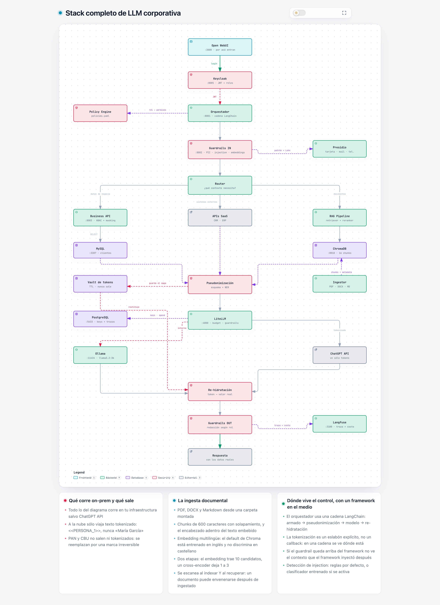

# Zero Trust LLM Gateway — POC

Stack para usar un modelo de frontera sobre datos de la empresa **sin que el dato
cruce el borde**, armado entero con open source y reproducible con un
`docker compose up`.

El proveedor ve esto:

```
¿Cuál es el saldo del cliente <<PERSONA_1>> y en qué segmento está?
```

El usuario ve esto:

```
El saldo del cliente María García es de 152.340,75 y está en el segmento premium.
```



---

## Qué levanta

| Servicio | Puerto | Para qué |
|---|---|---|
| Open WebUI | 3000 | el front por donde entran los usuarios |
| Orquestador **seguro** | 8001 | policy + router + guardrails + pseudonimización |
| Orquestador **inseguro** | 8000 | el mismo código sin controles: el "antes" |
| LiteLLM | 4000 | gateway: virtual keys, budget, rate limit, guardrails |
| Guardrails | 8002 | PII/PCI, injection, pseudonimización, embeddings y reranking |
| Business API | 8003 | ABAC + field masking sobre MySQL |
| Keycloak | 8085 | identidad: JWT con roles (sustituible por Entra ID u Okta) |
| Langfuse | 3100 | traza, costo, qué contexto se usó |
| ChromaDB | 8010 | vector store del RAG |
| Ollama | 11434 | modelo on-prem |
| MySQL / PostgreSQL | 3307 / 5433 | datos de negocio / estado del gateway |

## Requisitos

- Docker con **al menos 8 GB** asignados. El stack entero más el modelo local
  no entra en menos; si Ollama tira `model requires more system memory`, es esto.
- Opcional: una API key de OpenAI. Sin ella todo corre contra Ollama.
- Python 3.9+ con `requests` para los scripts de prueba.

---

# Paso a paso

## 1. Configurar

```bash
cp .env.example .env
```

Si tenés key de OpenAI, ponela en `OPENAI_API_KEY`. Si no, saltealo: la rama
cloud cae automáticamente al modelo local.

## 2. Levantar

```bash
docker compose up -d
```

La primera vez tarda: construye las imágenes y baja el modelo de NER en
español y el de embeddings multilingües. Verificá que todo esté sano:

```bash
docker compose ps
```

## 3. Cargar el modelo y los documentos

```bash
# Baja llama3.2 a Ollama (~2 GB la primera vez)
docker compose --profile setup run --rm seed

# Genera el corpus de prueba en PDF, DOCX y Markdown
docker compose --profile setup run --rm ingestor python generar_pdfs.py

# Lo chunkea, lo escanea y lo indexa en ChromaDB
docker compose --profile setup run --rm ingestor
```

La ingesta debería reportar algo así:

```
archivo                       tipo       chunks  alertas
----------------------------------------------------------------
onboarding.md                 markdown        4
politica-gastos.pdf           pdf             4
politica-vacaciones.docx      docx            3
politica-viajes.pdf           pdf             5  ⚠ 2 con alerta
----------------------------------------------------------------
4 archivos · 16 chunks indexados · 2 con alerta
```

**Las alertas son correctas**: `politica-viajes.pdf` tiene una inyección de
prompt plantada a propósito, y el escáner la detecta al indexar.

> Para usar tus propios documentos, dejalos en `documentos/` y volvé a correr
> el último comando. Soporta PDF, DOCX, Markdown y texto plano.

## 4. Ver el ruteo

```bash
pip install requests
python3 demo_router.py
```

Seis consultas, tres rutas. Fijate en la primera: recupera
`politica-viajes.pdf § Viáticos [SANEADO]` — el chunk envenenado, limpiado al
vuelo, con el dato legítimo intacto.

## 5. Atacarlo

```bash
python3 attack_llm.py --md resultados.md
```

Lanza la misma batería contra los dos orquestadores. Esperá algo así:

```
Sin gateway : 4/7 ataques exitosos
Con gateway : 7/7 ataques contenidos
Control benigno: sigue funcionando ✅
```

## 6. Mirarlo por dentro

| Dónde | URL | Credenciales |
|---|---|---|
| El asistente | http://localhost:3000 | sin login |
| Trazas y costos | http://localhost:3100 | `admin@zt.local` / `langfuse123` |
| Keys y budgets | http://localhost:4000/ui | `admin` / el `LITELLM_MASTER_KEY` del `.env` |
| Identidad | http://localhost:8085 | `admin` / `admin` |

Usuarios de la POC (realm `zt-llm`):

| Usuario | Password | Rol | Ve |
|---|---|---|---|
| `soporte1` | `soporte123` | soporte | cliente sin datos financieros |
| `finanzas1` | `finanzas123` | finanzas | + saldo y CUIT, PAN enmascarado |
| `auditor1` | `auditor123` | auditoria | todo, y nunca sale a la nube |

## 7. Tests que no necesitan el stack

```bash
python3 tests/test_patrones.py        # patrones de detección contra el corpus
python3 tests/comparar_motores.py     # heurístico vs clasificador (requiere guardrails arriba)
```

## Apagar

```bash
docker compose down            # conserva los volúmenes
docker compose down -v         # borra todo, incluido el modelo descargado
```

---

# Cómo funciona

## Las dos decisiones de ruteo

La **primera** decide a qué datos llega la consulta: documentos, datos de
negocio, o nada. La **segunda** decide a qué modelo puede ir ese contexto.

La segunda es la que importa. En `orchestrator/policies.yaml` es una tabla,
no un `if`:

```yaml
finanzas:
  modelos:
    documental: cloud      # sale, pero pseudonimizado
    negocio: cloud         # sale, pero pseudonimizado
    general: cloud
  ver_entidades: [PERSONA, UBICACION, ORGANIZACION, EMAIL_ADDRESS, CUIT_AR]
  budget_usd: 5.0
  rpm: 60
```

## El contrato de la pseudonimización

1. **Si va a la nube, va tokenizado.** No es un flag por request: la única
   forma de llegar a un modelo externo es pasando por el pseudonimizador.
2. **PAN y CBU no son tokenizables.** Se reemplazan por una marca irreversible
   que nunca se restituye: un PAN tokenizado igual mete al proveedor en el
   alcance de PCI-DSS.
3. **El mapa vive poco y no sale.** Token → valor queda en un vault con TTL y
   se borra al terminar la consulta.

## Dónde vive el control

El orquestador usa una cadena LangChain, y la tokenización es un eslabón
explícito:

```python
cadena = (RunnableLambda(armar)              # system + contexto + pregunta
          | RunnableLambda(pseudonimizar)    # <-- el control, acá
          | llm                              # ChatOpenAI -> LiteLLM
          | StrOutputParser()
          | RunnableLambda(rehidratar))
```

Si el guardrail queda **arriba** del framework no ve el contexto que el
framework inyectó después, que es donde está el dato sensible.

## Las cinco familias de ataque

Cada una cae en una capa distinta. Si todas cayeran en la misma, esa capa
sería un único punto de falla con buena prensa.

| # | Familia | Dónde se corta |
|---|---------|----------------|
| 1 | Inyección directa | guardrail de entrada |
| 2 | Inyección **indirecta** vía documento del RAG | escaneo del contexto, al ingestar y al recuperar |
| 3 | Exfiltración vía Business API | ABAC: el dato nunca entra al prompt |
| 4 | Fuga de PII/PCI en la respuesta | redacción de salida |
| 5 | Bypass del orquestador con key filtrada | guardrail del gateway |

---

# Decisiones que conviene saber

**El embedding es multilingüe y lo sirve el mismo servicio que la consulta.**
`paraphrase-multilingual-MiniLM-L12-v2`, servido desde guardrails para que
indexación y consulta usen exactamente el mismo modelo — si no, las distancias
no significan nada. Vale revisar esto en cualquier RAG cuyo corpus no esté en
inglés: el default de ChromaDB (`all-MiniLM-L6-v2`) está entrenado en inglés y
no discrimina bien en castellano.

**El RAG es de dos etapas.** El embedding trae 10 candidatos; un cross-encoder
multilingüe los reordena y quedan 1 a 3, con umbral **relativo** al mejor
(los puntajes varían mucho por consulta: 0.44 para una, 0.04 para otra, y las
dos aciertan). Cada chunk irrelevante que entra al contexto es superficie de
ataque, no sólo ruido.

**PII por esquema, no por adivinanza.** La columna `nombre` de una tabla ES un
nombre: `orchestrator/app.py` mapea campo a tipo de entidad y se lo pasa al
pseudonimizador como dato declarado. El NER queda sólo para texto libre, donde
no hay esquema que consultar — y ahí es best-effort, con una lista corta de
términos técnicos que nunca son PII para acotar los falsos positivos.

**Los guardrails corren dos veces.** En el orquestador (capa de aplicación) y
dentro de LiteLLM (capa de gateway). No es redundancia: el ataque 5 demuestra
que el código de aplicación se saltea y el gateway no.

**Keycloak es sustituible por tu IdP.** Está en la POC porque se levanta con el
compose y no necesita un tenant. En producción el lugar lo ocupa Entra ID, Okta
o el que ya administre las identidades. Lo único específico de Keycloak es dónde
deja los roles en el token, y eso es una variable:

```yaml
# Keycloak  -> realm_access.roles   (default)
# Entra ID  -> roles                (app roles) o groups
# Okta      -> groups
ROLES_CLAIM: ${ROLES_CLAIM:-realm_access.roles}
IDP_NOMBRE:  ${IDP_NOMBRE:-Keycloak}
```

El resto —validar la firma contra el JWKS, mapear rol a política— es OIDC puro.

**El vault es un sistema de identidad, y se trata como tal.** Al deidentificar
hacia el proveedor, el vault queda como el único componente capaz de revertirlo:
la joya se mueve de lugar. Por eso no se abre con una credencial de servicio del
gateway — valida el token **del usuario** contra el JWKS del IdP, ata cada mapeo
al `sub`, y sólo esa identidad puede revertirlo:

```
POST /rehidratar  sin token            -> 401
POST /rehidratar  con otra identidad   -> 403  (y queda auditado)
[vault] rehidratacion_denegada sesion=… pidio=… dueno=…
```

Si el vault se abriera con la identidad del gateway, la trazabilidad llegaría
hasta el gateway y ahí se cortaría: sabrías que algo se rehidrató, no quién lo
pidió. El mapeo además se borra al responder, antes de llegar al TTL.

> Gracias a [Alejandro Gabriel Cambeiro](https://www.linkedin.com/in/alejandro-gabriel-cambeiro/)
> por señalar esto: la versión anterior abría el vault sin ninguna identidad.

**El router es por palabras clave, no por LLM.** Determinístico y auditable.
Un clasificador LLM en el router es un punto de inyección más.

**Evaluamos LlamaFirewall y quedó afuera.** `PromptGuard 2` está gated en
HuggingFace: sin licencia aceptada abre un login interactivo y el servicio no
arranca en un contenedor. Y `AlignmentCheck` manda el razonamiento del agente
a la API de Together por defecto — para auditar que no te desviaste, exfiltra
lo que querías proteger.

**Los datos son mock.** Los PAN de `mysql/init/01-schema.sql` son números de
prueba públicos de las marcas: pasan Luhn pero no son tarjetas reales. Los
DNI, CUIT y CBU son inventados con formato argentino.
